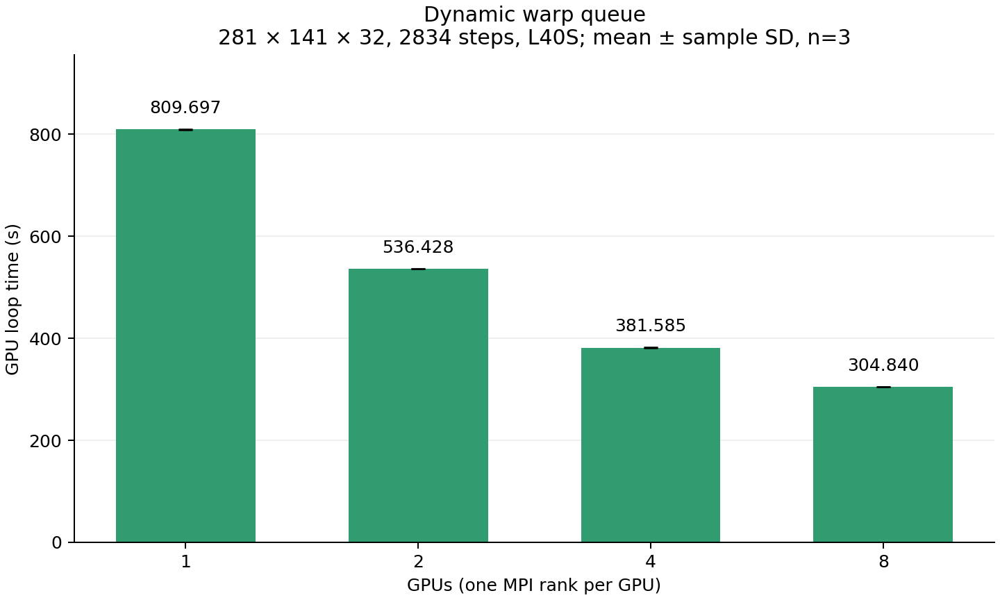

# EU3D CUDA/MPI

三维反应流求解器。MPI 负责域分解，每个 rank 使用一张 GPU，CUDA 执行对流与化学反应计算。当前工作围绕反应任务的负载差异，逐步加入跨 GPU 迁移、Nchem 分桶和 warp 动态任务队列。

## 算法概览

各格点的反应子步数 Nchem 不同，计算量也不同。算法分三层平衡这些工作：

1. **GPU 之间**：用各 rank 的 Nchem 总和估计负载，将部分反应任务从重载 GPU 迁移给轻载 GPU，完成后返回结果。成本门控控制迁移规模，CUDA-aware MPI 与独立 stream 支持设备数据传输及本地计算、远端求解和结果回传的重叠。
2. **warp 内部**：本地格点按 Nchem 分成 8 个桶，让同一 warp 的线程处理子步数相近的格点，减少轻任务结束后等待重任务的时间。
3. **warp 之间**：每个 warp 从共享队列一次领取同一桶内最多 32 个格点，各 thread 分别完成一个格点的反应计算。整块完成并同步后，warp 继续领取下一块；先完成的 warp 可以继续处理剩余任务。

这里的轮转计算是“领取 → 计算 → 同步 → 再领取”。任务由 warp 成块领取，格点由 thread 独立求解；各 warp 按完成速度取任务，从重桶逐步进入轻桶。

工作脉络为：**CUDA/MPI 求解 → 跨 rank 负载平衡 → 通信与计算重叠、成本门控 → Nchem 分桶 → warp 动态轮转**。当前实验以静态分桶版为对照，比较加入动态领取后的运行时间。详细流程与源码入口见 [方法说明](docs/METHODS.md)。

## 当前结果

CX3 L40S，281×141×32 网格，2834 步，每个 rank 使用一张 GPU，每个配置运行 3 次。

| GPU 数 | GPU loop 均值 (s) | 样本标准差 (s) | 相对同批静态分桶耗时下降 |
|---:|---:|---:|---:|
| 1 | 809.697 | 0.525 | 15.10% |
| 2 | 536.428 | 0.171 | 22.19% |
| 4 | 381.585 | 0.928 | 23.43% |
| 8 | 304.840 | 0.517 | 28.25% |




## 目录

| 目录 | 内容 |
|---|---|
| `solver/` | 源码、输入、Makefile、测试和 PBS 运行脚本 |
| `analysis/` | 当前结果绘图与日志分析脚本 |
| `output_1/`、`output_2/`、`output_4/`、`output_8/` | 按 MPI 进程数分类的网格参数、负载、结果检查和计时 |
| `results/summary/` | 跨 GPU 规模的汇总表 |
| `results/figures/` | 当前动态版性能图 |
| `results/analysis/` | 当前动态版的计时、通信量和 rank 调度分析 |
| `docs/` | 方法、结果和运行说明 |
| `tools/` | 文件与实验记录检查 |

## 构建与运行

需要 CUDA、MPI 和 NVIDIA GPU。PBS 脚本针对 CX3 L40S。

```bash
cd solver
make -j4 ARCH=-arch=sm_89 NUMERIC_MODE=native
bash submit_queue_all.sh
```

运行时创建 `output_<MPI进程数>/`，其中 `grid/` 存网格，`load/` 存负载，`results/` 存数值场，`time_record/` 存计时。PBS 在临时目录运行，再将日志和结果归档到 `solver/intragpu_results/`。

仓库顶层的 `grid/` 保存网格输入参数，`load/` 保存日志提取的负载记录，`results/` 保存输出检查记录，`time_record/` 保存计时和原始日志。

阅读：[方法](docs/METHODS.md) · [结果](docs/RESULTS.md) · [复现](docs/REPRODUCING.md)。
